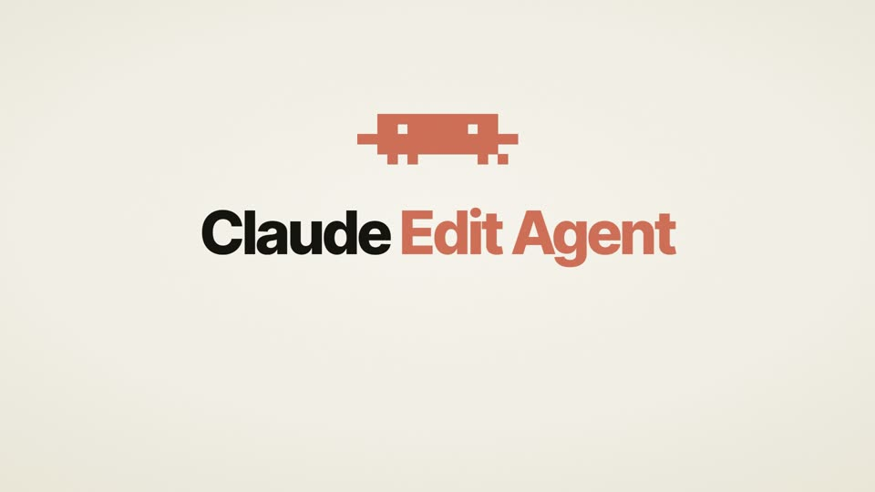

# AI Video Edit Recipes

Short videos edited by an AI agent (Claude Code), each with the prompt that made it, what you hand the AI, the tools, the cost and — for most of them — the full editable project.

**[Open the gallery](index.html)** · **[Watch the 2-minute intro](intro/)** · [Tiếng Việt](README.vi.md)

[](intro/)

| Section | What you'll find |
|---|---|
| Real estate | sketch → real home, map → 3D massing → footage, floor-plan tours, aerial location pins, editorial listings |
| Product ads | perfume, gimbal, headphones, drone, car, sports gear, 3D exploded view, carousel |
| Education | split-screen expert talk, vocabulary boards, cartoon explainers, space and nature facts |
| Everyday edits & news | word-by-word captions, cut-to-the-beat montage, news explainer, map storytelling |
| 3D & code | voxel and low-poly scenes, tiny rooms, pixel art, kinetic type |

Every recipe lives in [`recipes/<id>/`](recipes/): a README with the prompt and, where available, `source/` — a [HyperFrames](https://hyperframes.heygen.com) project (HTML + GSAP rendered to MP4).

## How to make one yourself

1. Install [Claude Code](https://claude.com/claude-code), [Node.js 22+](https://nodejs.org) and [ffmpeg](https://ffmpeg.org).
2. Open a folder with your footage or photos in Claude Code.
3. Paste a prompt from the gallery and change the names, text and length to yours.
4. The agent builds a HyperFrames project, checks its own frames, and renders an MP4 (`npx hyperframes render`).

To re-render a published project: copy `recipes/<id>/source/`, add the media listed in its `MEDIA.md`, then run `npx hyperframes render`.

## What it costs

| Tool | Cost | Used for |
|---|---|---|
| Claude Code | your Claude plan | writing and checking every edit |
| HyperFrames, ffmpeg, OpenCV, rembg, faster-whisper, librosa | free, local | rendering, line drawings, cut-outs, captions, beat detection |
| Pexels | free | stock footage |
| HeyGen, Vbee, other TTS | paid credits | avatars and voices (only the recipes marked so) |

Most recipes are **free** apart from your Claude plan.

## Running the gallery locally

```bash
node tools/serve.mjs 4340   # then open http://localhost:4340
```

The finished MP4s are not in git (they are large). They are attached to the GitHub Release; `VIDEO_BASE` at the top of `index.html` points the page at them. `tools/build.py` rebuilds `gallery/data.js`, the posters and `recipes/` from `recipes.json`.

## Credits and licence

- Stock footage: [Pexels](https://www.pexels.com) creators (Alef Morais, TR Studio, cottonbro studio, Taryn Elliott, Tima Miroshnichenko, Sergei Starostin, Michael Burrows and others), used under the Pexels licence. Footage is not redistributed in this repo.
- Brand names in the videos (NOIR, AXIS, HUSH, ACE, SKYLINE MINI, VANTA GT, Tropical Villa…) are fictional.
- Code and prompts: MIT (see [LICENSE](LICENSE)).
