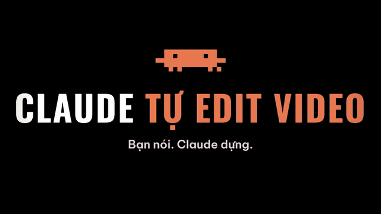

# Claude Edit Agent: skill edit video cho Claude

**Skill giúp Claude tự edit video cho bạn**, kèm bộ 41 video mẫu do chính skill làm ra. Mỗi video có câu lệnh đã dùng, bạn cần đưa cho AI cái gì, công cụ nào, tốn bao nhiêu, và với phần lớn video là cả dự án để sửa lại.

[](https://github.com/ducloc99/ai-video-edit-recipes/releases/download/v1/intro.mp4)

**[▶ Xem trailer 2 phút](https://github.com/ducloc99/ai-video-edit-recipes/releases/download/v1/intro.mp4)** · **[Cài skill](#cài-skill)** · [Mở trang xem video](index.html) · [English](README.md)

## Cài skill

Trong Claude Code, gõ:

```text
/plugin marketplace add ducloc99/ai-video-edit-recipes
/plugin install edit-agent@ai-video-edit-recipes
```

Hoặc chỉ cần nói với Claude Code: *"Cài skill từ https://github.com/ducloc99/ai-video-edit-recipes theo file INSTALL.md"*, Claude sẽ tự làm từng bước. Chi tiết, yêu cầu máy và cách cài bằng tay ở [INSTALL.md](INSTALL.md).

Cài xong, mở lại Claude Code (phiên mới) để skill được nạp.

## Dùng thế nào

1. Mở thư mục chứa video hoặc ảnh của bạn trong Claude Code.
2. Nói điều bạn muốn, ví dụ: *"Dựng mấy clip này thành quảng cáo 15 giây, chữ thật to nằm sau sản phẩm, chỉ có nhạc."*
3. Claude chọn mẫu gần nhất trong bộ sưu tập, xử lý footage, dựng video, tự chụp khung hình để kiểm tra rồi xuất MP4.

Muốn giống hệt một video mẫu: mở trang xem video, bấm vào video, bấm **Copy** câu lệnh, dán vào Claude rồi đổi tên, chữ, độ dài cho đúng của bạn.

## Cần gì

- [Claude Code](https://claude.com/claude-code), [Node.js 22+](https://nodejs.org), [ffmpeg](https://ffmpeg.org), Python 3.10+
- HyperFrames (miễn phí, tự tải qua `npx`)
- Tuỳ tính năng: `librosa` (cắt theo nhịp), `rembg` (chữ nằm sau người/sản phẩm), `faster-whisper` (phụ đề)

## Chi phí

Phần lớn video **miễn phí** ngoài gói Claude: mọi công cụ dựng chạy trên máy, footage lấy từ Pexels. Chỉ các video ghi "credits" mới tốn tiền (HeyGen, Vbee hoặc giọng đọc AI khác).

## Xem trang video trên máy

Video không nằm trong git vì nặng. Tải về bằng `gh release download v1 -D videos`, rồi chạy `node tools/serve.mjs 4340` và mở http://localhost:4340.

## Ghi nguồn

Footage từ các tác giả trên Pexels (không phân phối lại trong repo). Tên thương hiệu trong video là hư cấu. Code và câu lệnh: MIT.
