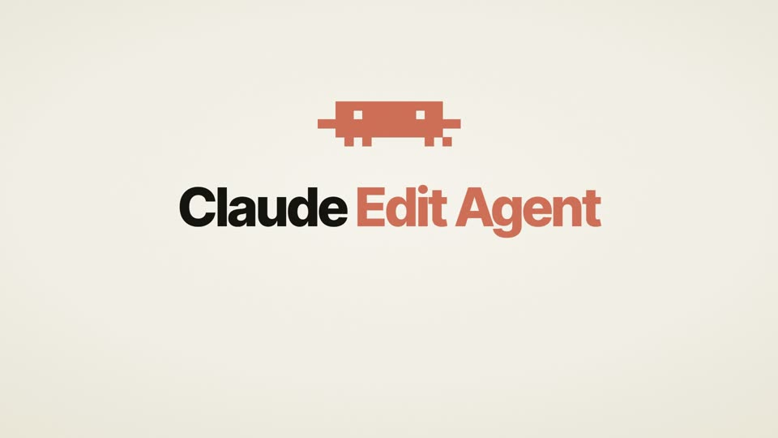

# Claude Edit Agent: the 2-minute intro



**You give the AI:** the finished gallery videos and a music brief  
**Tools:** Claude Code, HyperFrames, Suno (music), librosa (beats)  
**Cost:** about 12 Suno credits for the music; everything else is free  
**Length:** 2:03, 1920x1080

## Prompt

```text
Make a 2-minute 16:9 intro for "Claude Edit Agent" from the videos in this gallery, in English, no voice-over.
Light editorial look (warm off-white page, serif headlines, the orange pixel mascot as the only brand mark).
Open on three raw headphone clips: "You shot the footage." Then a prompt card types the request, the mascot
walks along a film strip while frames are cut out, and the finished headphone ad plays next to the raw clip.
Show the name, then one chapter per industry (real estate, product ads, education, everyday edits, 3D & code):
the chapter's request is typed into the prompt card, then its results slide in as single, side-by-side or
three-up cards. End on a moving wall of every video ("Every video here comes with its prompt.") and the name.
Make a new instrumental track with a different feel from earlier intros (funky breakbeat, slap bass, brass, ~100 bpm),
detect its beats and put every cut on a beat. No counters, numbering, dots or glow.
```

## How it was built

`source/tools/gen.py` writes `index.html` from the beat grid in `tools/beats.json`; `tools/prep.py` cuts the short clips it plays.
To render: add the media listed in `source/MEDIA.md`, run `python tools/prep.py`, `python tools/gen.py`, then `npx hyperframes render`.
