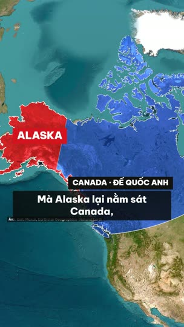

# Map storytelling



**You give the AI:** A prompt  
**Tools:** Claude Code, Mapbox/GeoJSON, HyperFrames  
**Cost:** Free  
**Length:** 41s, 1080x1920

## Prompt

```text
Explain why Alaska belongs to the USA, not Canada: a satellite-style map, country shapes light up, the camera flies between places while short captions tell the story.
```

## Source

Made with an earlier pipeline; only the prompt is published.
