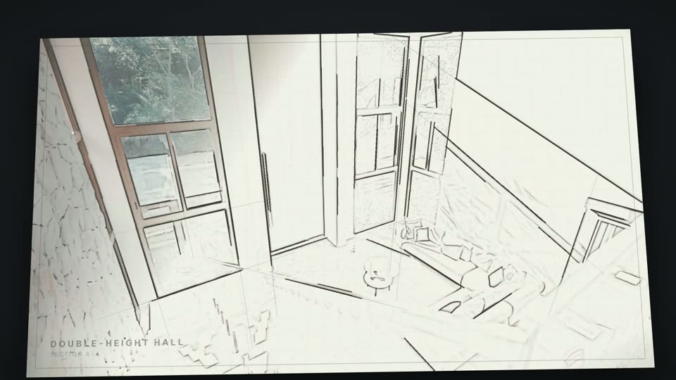

# Sketch to real home



**You give the AI:** Video you shot  
**Tools:** Claude Code, HyperFrames, OpenCV (line drawing), Pexels footage  
**Cost:** Free  
**Length:** 15s, 1920x1080

## Prompt

```text
Make a 15s 16:9 real-estate film from my villa clips. Turn one still frame into an architect's pencil sketch (OpenCV line drawing) that draws itself on a sheet of paper lying in 3D, then the paper tilts up and dissolves into the real footage of the same angle. Do it for three angles (facade, double-height hall, living room) with a thin label for each, end on a clean title card. Music only, no whoosh sound effects.
```

## Source

`source/` is the HyperFrames project. Add the media listed in `source/MEDIA.md`, then run `npx hyperframes render`.
