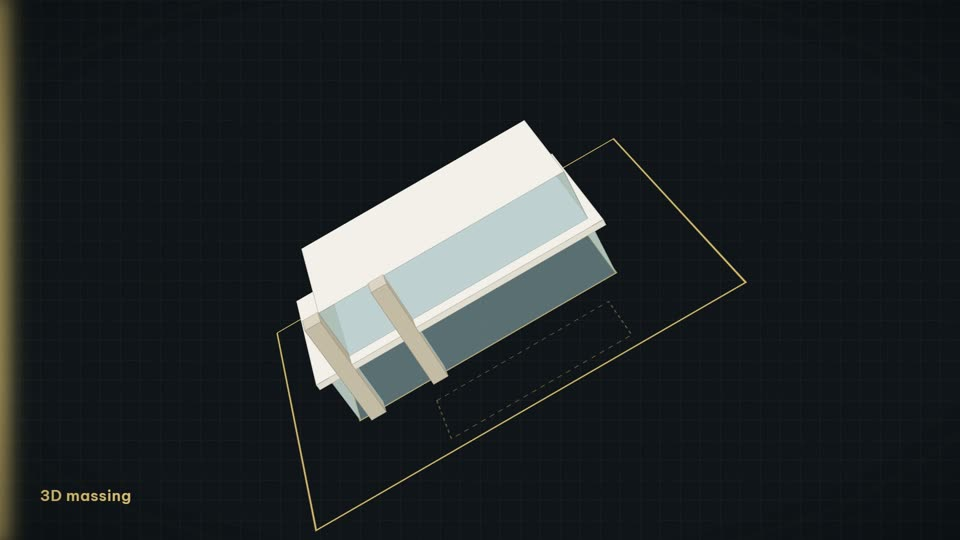

# Map to 3D to real home



**You give the AI:** A prompt  
**Tools:** Claude Code, HyperFrames, CSS 3D, Pexels footage  
**Cost:** Free  
**Length:** 17s, 1920x1080

## Prompt

```text
15s 16:9 real-estate reveal: start on a dark map, zoom into the plot, draw the site plan with thin gold lines, extrude it into simple 3D blocks that rise floor by floor, then a light scan wipes the blocks into real footage of the finished villa. Three quiet step labels (Site plan, 3D massing, Built) and a minimal title at the end. Music only.
```

## Source

`source/` is the HyperFrames project. Add the media listed in `source/MEDIA.md`, then run `npx hyperframes render`.
