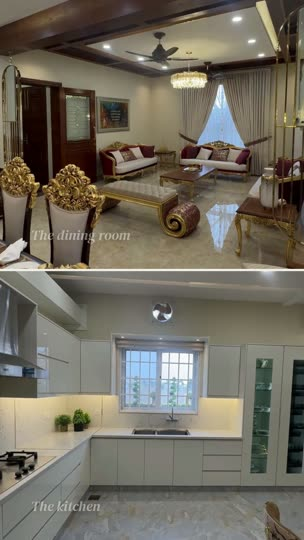

# Editorial listing



**You give the AI:** Video you shot  
**Tools:** Claude Code, HyperFrames, Pexels footage  
**Cost:** Free  
**Length:** 17s, 1080x1920

## Prompt

```text
17s 9:16 luxury listing in a magazine style from my interior clips, music only. Open on an ivory page where a big serif headline 'Light lives here.' is a window onto the living room, zoom through a letter into full-frame footage, a dining push-in with the spec line '4 Bedrooms — 320 m² — Sea view' appearing word by word, a two-room split, tall columns that open to the bedroom, and end with the villa folding back into a framed window and the lockup 'Maison Aurelle — Private viewing by appointment'. Cut on the beat.
```

## Credits

Footage: TR Studio (Pexels).

## Source

`source/` is the HyperFrames project. Add the media listed in `source/MEDIA.md`, then run `npx hyperframes render`.
