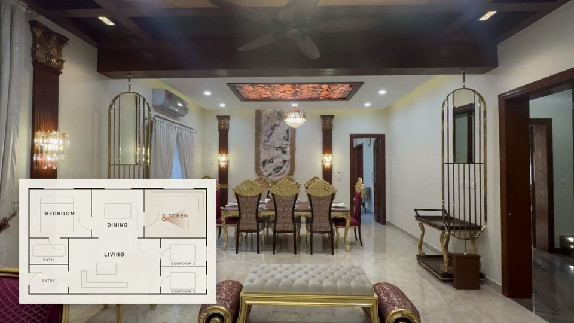

# Floor-plan tour



**You give the AI:** Video you shot  
**Tools:** Claude Code, HyperFrames, SVG, Pexels footage  
**Cost:** Free  
**Length:** 18s, 1920x1080

## Prompt

```text
18s 16:9 apartment tour from my room clips, music only. A thin charcoal floor plan draws itself on warm paper, a small camera marker with a view cone enters and walks room to room (living, dining, kitchen, bedroom); each room's footage opens out of the cone and fills the frame while the plan shrinks into a corner inset that highlights the current room. End on 'The Linden Residence · 3 BR · 140 m²'.
```

## Credits

Footage: TR Studio (Pexels).

## Source

`source/` is the HyperFrames project. Add the media listed in `source/MEDIA.md`, then run `npx hyperframes render`.
