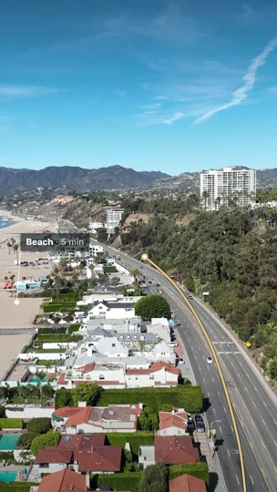

# Aerial location pins



**You give the AI:** Video you shot  
**Tools:** Claude Code, HyperFrames, OpenCV (point tracking), Pexels footage  
**Cost:** Free  
**Length:** 16s, 1080x1920

## Prompt

```text
16s 9:16 'location' reel for a residential tower from drone footage, music only. A pin drops on the tower roof with the project name, then thin leader lines and labels pop for nearby places with travel times (International school · 8 min, Metro · 3 min, Beach · 5 min); track each target point with OpenCV so the labels stay locked to the buildings as the drone moves. A gold route line draws along the road to 'Downtown · 12 min'. End on a clean lockup 'MARINA ONE — Coming 2027'.
```

## Credits

Footage: Đình Luật and other Pexels creators.

## Source

`source/` is the HyperFrames project. Add the media listed in `source/MEDIA.md`, then run `npx hyperframes render`.
