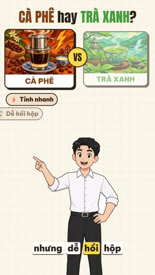

# This or that



**You give the AI:** A document  
**Tools:** Claude Code, HyperFrames, TTS voice  
**Cost:** Voice credits  
**Length:** 23s, 720x1280

## Prompt

```text
Compare two things (coffee or green tea): two cards side by side, a presenter points at each, short pros appear as the voice says them.
```

## Source

Made with an earlier pipeline; only the prompt is published.
