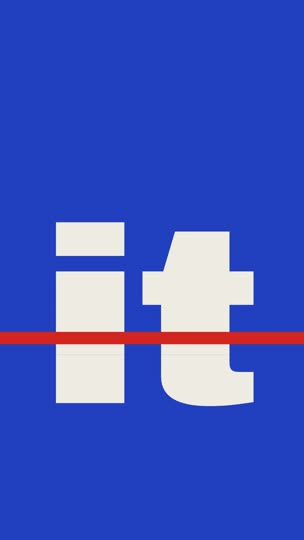

# Swiss kinetic type



**You give the AI:** A prompt  
**Tools:** Claude Code, HyperFrames, GSAP  
**Cost:** Free  
**Length:** 17s, 1080x1920

## Prompt

```text
Make a 16-second 9:16 (1080x1920) kinetic typography reel in HyperFrames (HTML/CSS/GSAP only, no images, no AI art), styled like a Swiss/Bauhaus design-studio poster series. Use the line "Design is how it moves." and give each word its own poster, hard-cut on the beat of a punchy minimal electronic track (about 112 BPM). Use only four flat colours: off-white paper, ink black, signal red and cobalt blue. Use one variable font (Archivo, with weight and width axes) and animate its axes through CSS variables. Give each poster its own shape idea. "Design": the letters arrive sliced into halves over a red circle, go thin and wide, then slam back to heavy and condensed. "is": the i is built from a black bar plus a bouncing red-circle dot, the s rotates in, and a blue half-circle rises. "how": the o is a half-blue disc that drops in and shoves the w aside. "it": the word stretches up from a line, is sliced by a red bar, and the colour field flips from blue to paper. "moves.": stepping ribbons of the word in weights that wave, with one red word fixed in the centre. End on a clean held poster with the full line in heavy condensed type, a red sun, a blue disc, a black rule and two small captions. Use only transform, opacity, clip-path and font-variation animation. Add no numbering, counters, glow or sound effects: music only.
```

## Source

`source/` is the HyperFrames project. Add the media listed in `source/MEDIA.md`, then run `npx hyperframes render`.
