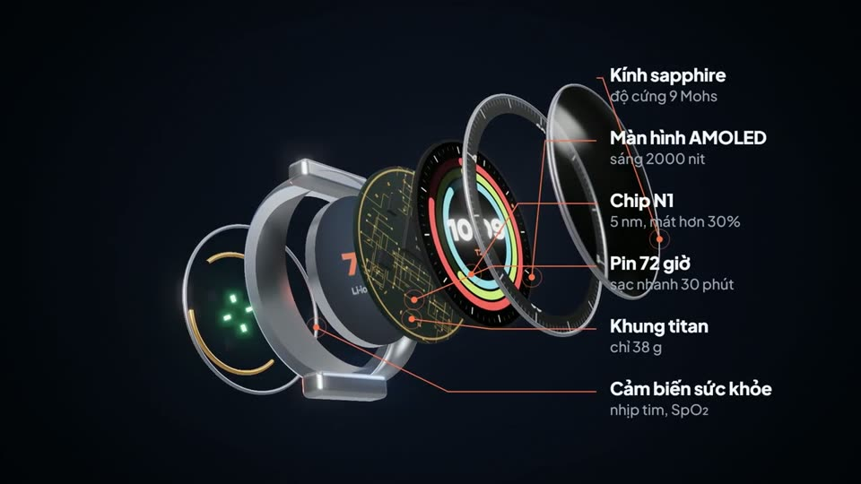

# Watch exploded view



**You give the AI:** A prompt  
**Tools:** Claude Code, Three.js  
**Cost:** Free  
**Length:** 27s, 1280x720

## Prompt

```text
Smartwatch ad drawn fully in code with Three.js: the watch rotates, then separates into layers (sapphire glass, AMOLED screen, chip, battery, titanium case, sensors) with a thin label next to each layer, then snaps back together.
```

## Source

Made with an earlier pipeline; only the prompt is published.
