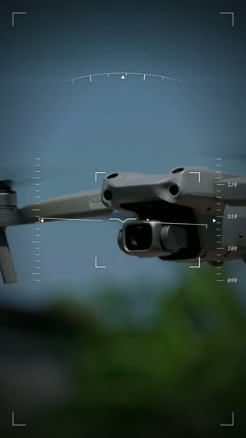

# Drone, see further



**You give the AI:** Video you shot  
**Tools:** Claude Code, HyperFrames, Pexels footage  
**Cost:** Free  
**Length:** 16s, 1080x1920

## Prompt

```text
16s 9:16 drone ad: take-off close-up, then the camera's view widens into aerial shots, thin spec lines appear next to the drone, end with 'SKYLINE MINI / See further.' Clean, little text, music only.
```

## Source

`source/` is the HyperFrames project. Add the media listed in `source/MEDIA.md`, then run `npx hyperframes render`.
