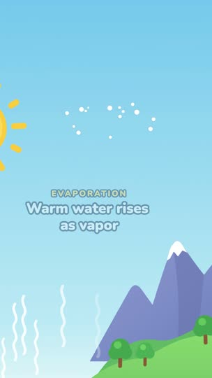

# How rain is made, cartoon



**You give the AI:** A prompt  
**Tools:** Claude Code, HyperFrames, SVG  
**Cost:** Free  
**Length:** 19s, 1080x1920

## Prompt

```text
19s 9:16 flat cartoon explainer of the water cycle, drawn fully in code, music only. A smiling sun warms the sea, vapor rises (evaporation), cools into a cloud (condensation), the cloud turns grey over the mountains and rains (precipitation), trees perk up and a river carries the water back to the sea (collection). Gentle continuous camera move, short labels, end with the camera pulling back while a loop arrow draws the whole cycle.
```

## Source

`source/` is the HyperFrames project. Add the media listed in `source/MEDIA.md`, then run `npx hyperframes render`.
