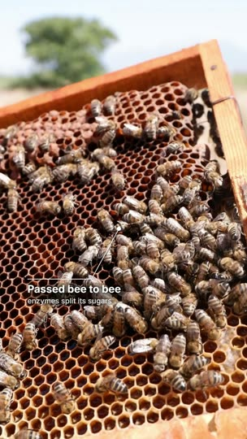

# How bees make honey



**You give the AI:** A prompt  
**Tools:** Claude Code, HyperFrames, Pexels footage  
**Cost:** Free  
**Length:** 19s, 1080x1920

## Prompt

```text
19s 9:16 nature explainer from real footage, music only. A honeybee on a flower with a label that follows it, a freeze frame with thin callout lines to the tongue and the honey stomach, then three hive shots with one callout each (passed bee to bee, fanned to dry, capped with wax), end on honey pouring: 'Nectar, made to last.' No numbers, only facts you are sure of.
```

## Credits

Footage: Feel of the Nature, İrem Meriç and other Pexels creators.

## Source

`source/` is the HyperFrames project. Add the media listed in `source/MEDIA.md`, then run `npx hyperframes render`.
