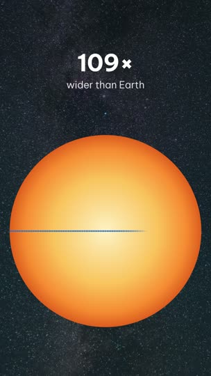

# How big is the Sun?



**You give the AI:** A prompt  
**Tools:** Claude Code, HyperFrames, Pexels footage  
**Cost:** Free  
**Length:** 17s, 1080x1920

## Prompt

```text
17s 9:16 space fact reel, music only. Open on Earth from orbit with the question 'How big is the Sun?'. Over a Milky Way shot, draw Earth and the Sun to true scale, line 109 small Earths across the Sun's width ('109x wider than Earth', '1.3 million Earths would fit inside'), then match the drawn Sun onto a real sunrise above the clouds: 'Its light takes about 8 min to reach us'. Use only facts you are sure of.
```

## Credits

Footage: Adis Resic, Dmitry Varennikov, Orhan Pergel (Pexels).

## Source

`source/` is the HyperFrames project. Add the media listed in `source/MEDIA.md`, then run `npx hyperframes render`.
