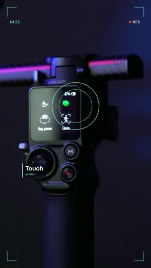

# Gimbal, HUD callouts



**You give the AI:** Video you shot  
**Tools:** Claude Code, HyperFrames, Pexels footage  
**Cost:** Free  
**Length:** 16s, 1080x1920

## Prompt

```text
16s 9:16 tech ad for a phone gimbal. Thin HUD callout lines that follow the product and name one feature each (3-axis stabilised, quick-balance lock, touch screen), a viewfinder frame, smooth push-ins, end with 'Smooth in every frame'. Music only.
```

## Source

`source/` is the HyperFrames project. Add the media listed in `source/MEDIA.md`, then run `npx hyperframes render`.
