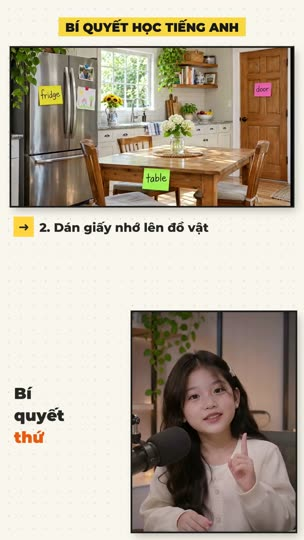

# Picture on top, speaker below



**You give the AI:** A prompt  
**Tools:** Claude Code, HeyGen avatar, GPT Image  
**Cost:** HeyGen + image credits  
**Length:** 55s, 720x1280

## Prompt

```text
Make a 9:16 tips video with a HeyGen avatar: picture for each tip on top, the avatar speaking below, a bold title bar and captions.
```

## Source

Made with an earlier pipeline; only the prompt is published.
