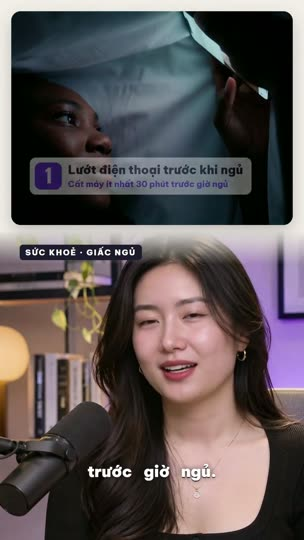

# Expert talk, split screen



**You give the AI:** Video you shot  
**Tools:** Claude Code, HeyGen avatar, Vbee voice, ffmpeg  
**Cost:** HeyGen + Vbee credits  
**Length:** 35s, 720x1280

## Prompt

```text
Vertical expert-talk reel: the speaker sits in the bottom half, the top half shows an illustration that changes with each idea, word-by-word captions with the key word highlighted.
```

## Source

Made with an earlier pipeline; only the prompt is published.
