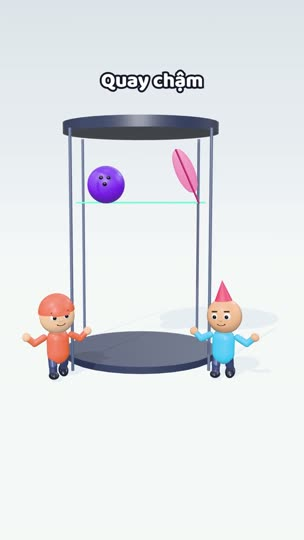

# 3D characters



**You give the AI:** A prompt  
**Tools:** Claude Code, Three.js  
**Cost:** Free  
**Length:** 26s, 720x1280

## Prompt

```text
Two cute 3D characters made from simple shapes watch a ball bounce in slow motion inside a glass tube.
```

## Source

Made with an earlier pipeline; only the prompt is published.
