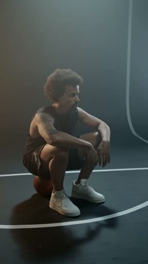

# Cut to the beat



**You give the AI:** Video you shot  
**Tools:** Claude Code, HyperFrames, librosa (beats), rembg (cut-out), Pexels footage  
**Cost:** Free  
**Length:** 17s, 1080x1920

## Prompt

```text
Cut these basketball clips into a 16-second vertical (1080x1920) montage that cuts to the beat of a dark trap/electronic track. Run beat detection on the music, and make every cut land on a beat, with the busiest cutting after the drop. Before the big moment, slow the footage right down, then snap back to fast speed on the hit. At the peak, freeze the frame for one beat: darken the background and draw a thin white outline around the player and the ball. Add a short camera shake on the three or four heaviest bass hits only. Use the words "NO DAYS OFF" and nothing else: stack them in a tall condensed font and bring in one word per snare hit during the quiet build. Keep the words off faces and inside the phone safe area. End on a clean dark card that shows the same three words over a faint copy of the player's outline. Play the music only, with no whoosh or pop sound effects. Don't add counters, dots, glow or any other decoration, and keep the footage as the main thing on screen.
```

## Credits

Footage: cottonbro studio (Pexels).

## Source

`source/` is the HyperFrames project. Add the media listed in `source/MEDIA.md`, then run `npx hyperframes render`.
