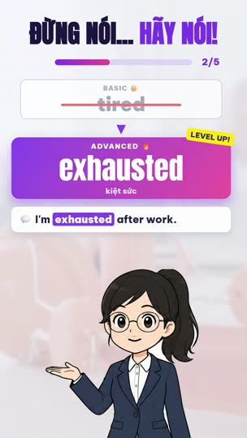

# Basic vs advanced word



**You give the AI:** A document  
**Tools:** Claude Code, HyperFrames, TTS voice  
**Cost:** Voice credits  
**Length:** 32s, 720x1280

## Prompt

```text
From my word list, make a vocabulary reel: the basic word gets crossed out and the advanced word levels up in its place, with an example sentence and a cartoon teacher.
```

## Source

Made with an earlier pipeline; only the prompt is published.
