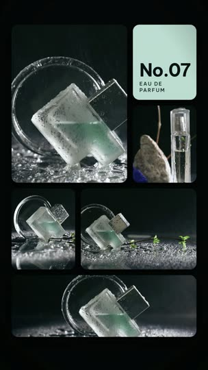

# Perfume, editorial



**You give the AI:** Video you shot  
**Tools:** Claude Code, HyperFrames, Pexels footage  
**Cost:** Free  
**Length:** 16s, 1080x1920

## Prompt

```text
16s 9:16 perfume ad from my bottle clips, dark and editorial. Open on a hairline word RAIN, use light-slat wipes and a bento grid of four shots, quick shutter cuts on the beat, end on a lockup 'NOIR / Night Rain'. Very little text, music only.
```

## Source

`source/` is the HyperFrames project. Add the media listed in `source/MEDIA.md`, then run `npx hyperframes render`.
