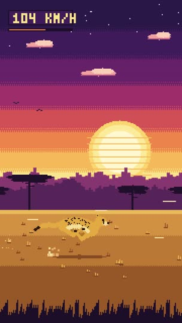

# Pixel-art sunset



**You give the AI:** A prompt  
**Tools:** Claude Code, Canvas  
**Cost:** Free  
**Length:** 12s, 720x1280

## Prompt

```text
A pixel-art sunset drive scene drawn in code: layered parallax hills, a big pixel sun, a speed counter in the corner.
```

## Source

Made with an earlier pipeline; only the prompt is published.
