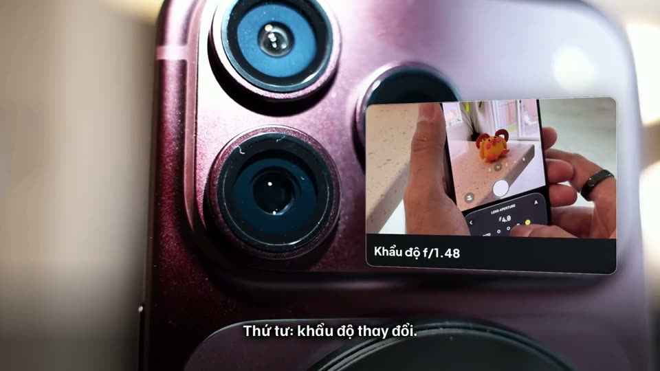

# Review with 3D photos



**You give the AI:** Video you shot  
**Tools:** Claude Code, HyperFrames  
**Cost:** Free  
**Length:** 32s, 1280x720

## Prompt

```text
Product review from my talking clip: when I mention a feature, a photo of it flips in on a 3D card beside me with a short label, captions at the bottom follow my voice.
```

## Source

Made with an earlier pipeline; only the prompt is published.
