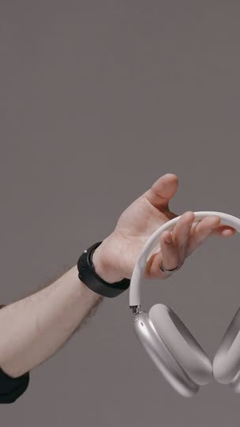

# Headphones, text behind



**You give the AI:** Video you shot  
**Tools:** Claude Code, HyperFrames, rembg (cut-out), Pexels footage  
**Cost:** Free  
**Length:** 16s, 1080x1920

## Prompt

```text
16s 9:16 headphone ad. Cut the headphones out with rembg and put a giant word QUIET behind them so the product overlaps the letters, a soft line 'Hear every breath of the music', a few polaroid-style frames dropping in, end on 'All sound. No noise.' Music only.
```

## Source

`source/` is the HyperFrames project. Add the media listed in `source/MEDIA.md`, then run `npx hyperframes render`.
