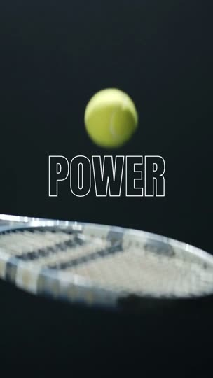

# Sports gear, freeze frame



**You give the AI:** Video you shot  
**Tools:** Claude Code, HyperFrames, rembg (cut-out), Pexels footage  
**Cost:** Free  
**Length:** 16s, 1080x1920

## Prompt

```text
16s 9:16 sports ad from tennis clips. STAY FOCUSED on the opening shot, a freeze frame where the player is cut out with a white outline and a giant word behind, an outlined POWER word on impact, a three-panel triptych, a stutter edit on the swing, end on 'Every shot has a purpose'. Music only.
```

## Source

`source/` is the HyperFrames project. Add the media listed in `source/MEDIA.md`, then run `npx hyperframes render`.
