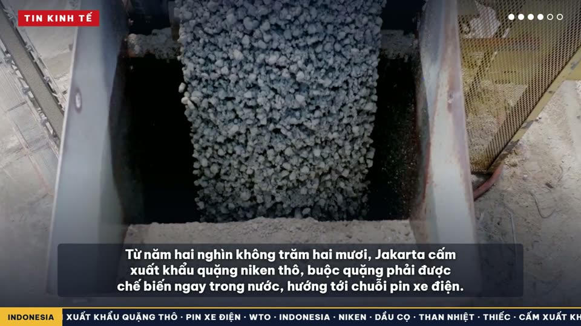

# News explainer



**You give the AI:** A document  
**Tools:** Claude Code, HyperFrames, Pexels footage, TTS voice  
**Cost:** Voice credits  
**Length:** 51s, 1280x720

## Prompt

```text
From this article, make a 9:16 news explainer: real footage for each point, numbers drawn in code, a lower-third ticker and captions.
```

## Source

Made with an earlier pipeline; only the prompt is published.
