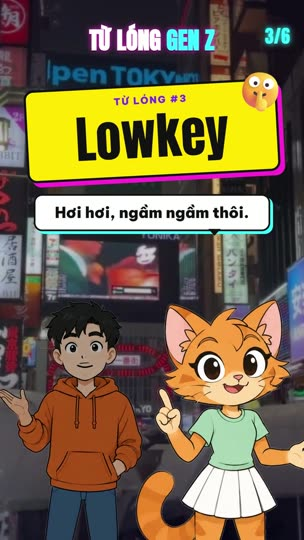

# Gen Z slang, cartoon



**You give the AI:** A document  
**Tools:** Claude Code, HyperFrames, TTS voice  
**Cost:** Voice credits  
**Length:** 26s, 720x1280

## Prompt

```text
Two cartoon characters on a night street teach one slang word: the word card pops up, its meaning, an example line, characters' mouths move with the voice.
```

## Source

Made with an earlier pipeline; only the prompt is published.
