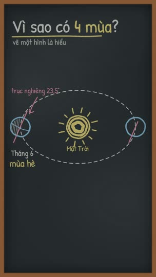

# Chalkboard drawing



**You give the AI:** A prompt  
**Tools:** Claude Code, SVG  
**Cost:** Free  
**Length:** 23s, 720x1280

## Prompt

```text
Explain why we have four seasons on a chalkboard: the sun, Earth's tilted orbit and labels are drawn stroke by stroke in chalk.
```

## Source

Made with an earlier pipeline; only the prompt is published.
