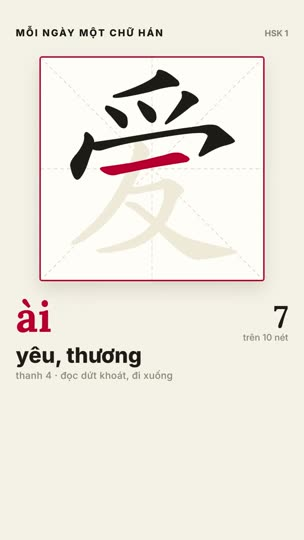

# Chinese character strokes



**You give the AI:** A prompt  
**Tools:** Claude Code, SVG stroke data  
**Cost:** Free  
**Length:** 14s, 720x1280

## Prompt

```text
Write the Chinese character 爱 stroke by stroke in the correct order on a practice grid, then show pinyin, meaning and stroke count.
```

## Source

Made with an earlier pipeline; only the prompt is published.
