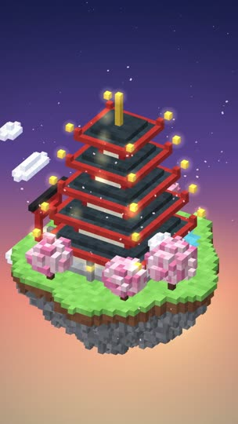

# Voxel temple



**You give the AI:** A prompt  
**Tools:** Claude Code, Three.js  
**Cost:** Free  
**Length:** 12s, 720x1280

## Prompt

```text
Build a floating voxel island with a pagoda and cherry trees in Three.js, slow orbit camera, soft dusk light.
```

## Source

Made with an earlier pipeline; only the prompt is published.
